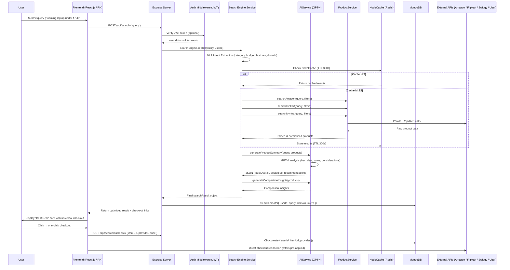
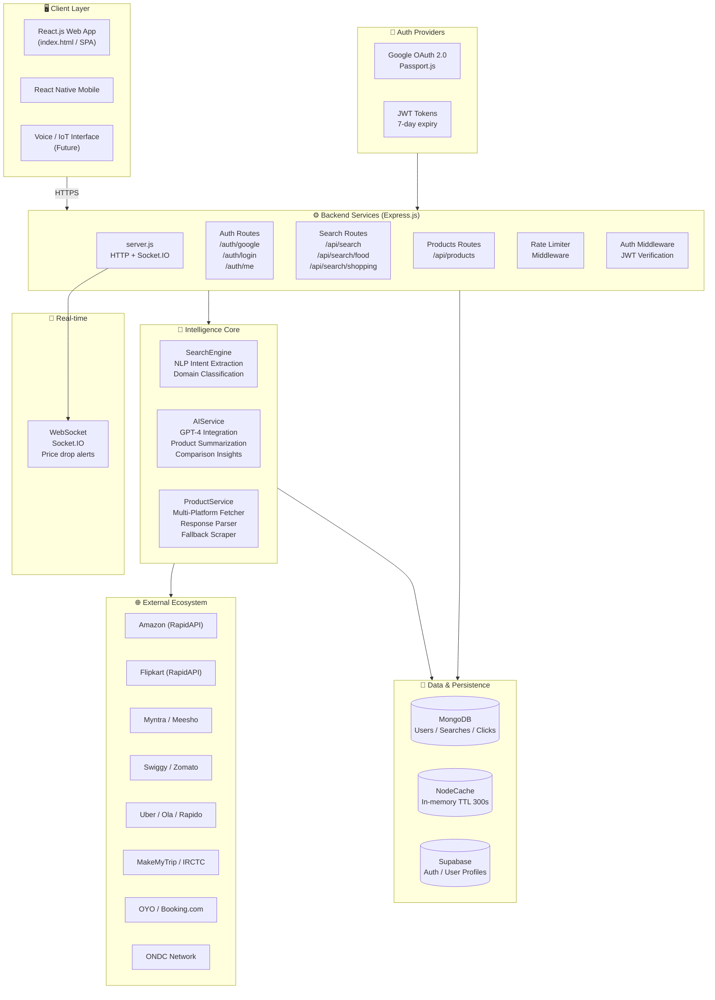
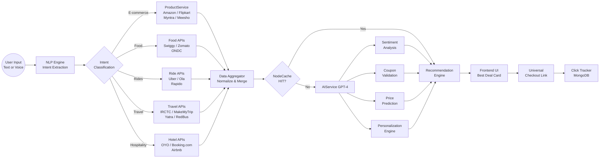
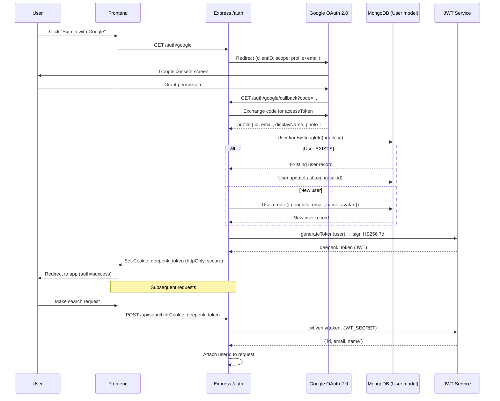
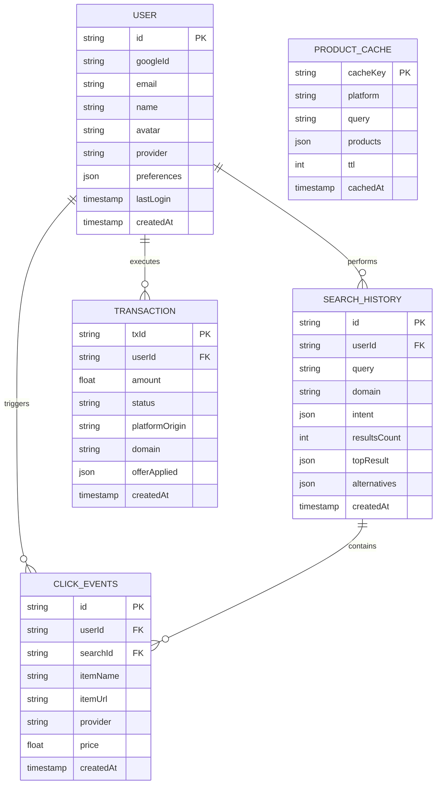
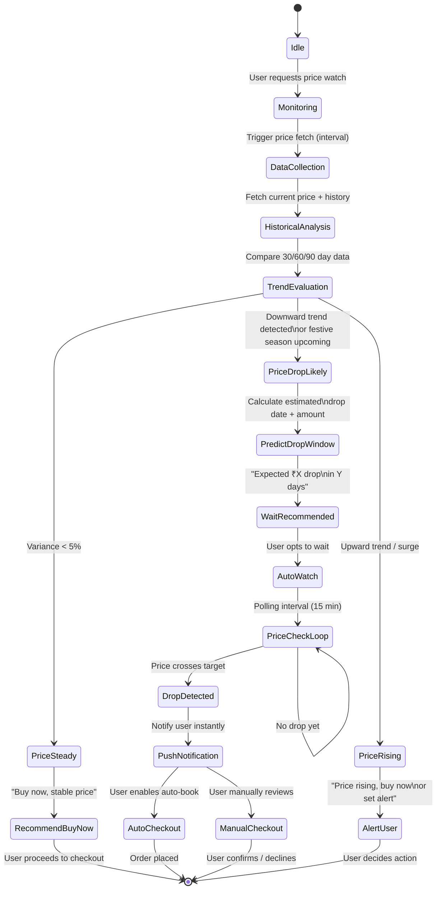
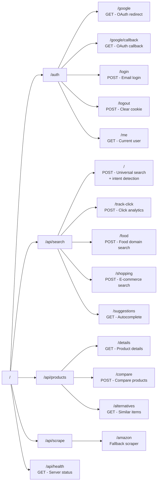
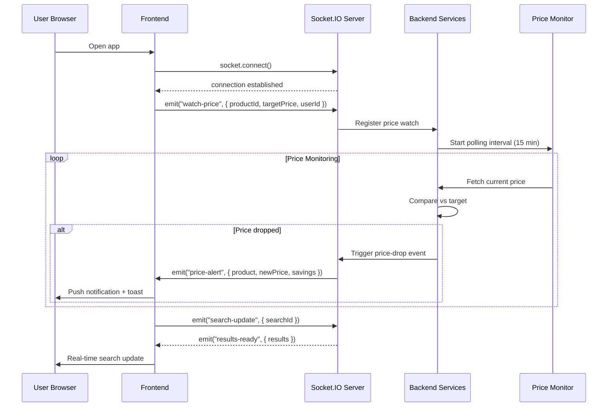

# Deepenk — Architecture Diagrams
> AI Decision Engine | All Mermaid Diagrams

---

## 1. Sequence Diagram — Intent to Checkout

---

## 2. System Architecture — Component Graph

---

## 3. Data Flow Diagram — Query to Recommendation

---

## 4. Authentication Flow — Google OAuth + JWT

---

## 5. Database Schema — Entity Relationship Diagram

---

## 6. State Diagram — Price Drop Prediction Logic

---

## 7. API Route Map — Backend Endpoint Structure

---

## 8. WebSocket — Real-time Events Flow

